# BurauenBiblio 📚🌴

🌐 **Baca dalam bahasa:**
[English](README.md) | **Bahasa Indonesia**

## Kredit dan Tujuan Proyek

**BurauenBiblio** merupakan karya turunan dari sistem **OpenBiblio** asli yang telah disesuaikan untuk lingkungan **PHP 8.3** modern dan kebutuhan perpustakaan sekolah di **Filipina**.

Proyek ini dikembangkan dan dipelihara sebagai inisiatif sumber terbuka berbasis komunitas untuk memperbarui serta memperluas fungsionalitas OpenBiblio, khususnya dalam mendukung perpustakaan kecil dan institusi pendidikan.

Nama BurauenBiblio diambil sebagai bentuk penghormatan kepada kampung halaman pengembang di Leyte, yaitu **Burauen**.

- Penulis OpenBiblio:
  **David Stevens, Joe Hagerty, Micah Stetson, Fred LaPlante**
  (Lihat LICENSE dan copyright.html untuk informasi atribusi lengkap.)

- Pemelihara BurauenBiblio: Ferdinand Tumulak

📌 Lihat [CHANGELOG.md](./CHANGELOG.md) untuk riwayat versi.

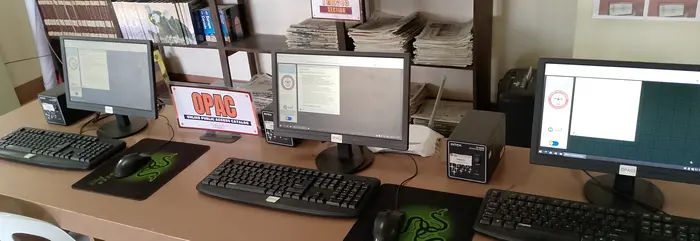

Repositori ini menyertakan sejumlah kecil contoh data bibliografi (buku) dan akun anggota fiktif dalam berkas SQL yang disediakan.

Data tersebut hanya digunakan untuk demonstrasi dan pengujian fungsionalitas sistem OpenBiblio.

Data buku bersifat fiktif atau diadaptasi dari sumber domain publik. Gambar thumbnail yang terkait digunakan berdasarkan ketentuan domain publik atau penggunaan wajar (*fair use*) untuk keperluan pendidikan dan demonstrasi.

Seluruh data anggota merupakan data fiktif dan tidak mewakili individu nyata.

## ✅ Mendukung PHP 8.3.37 Terbaru (Gunakan PHP 8.3.37)

PHP 8.3.37 dirilis untuk mengatasi sejumlah kerentanan keamanan, antara lain:

- CVE-2026-129496: *Timezone cache use-after-free* yang dapat menyebabkan eksekusi kode jarak jauh (*remote code execution*), serta CVE-2026-129291: *PHP-FPM epoll use-after-free* yang dapat menyebabkan peningkatan hak akses lokal.
- CVE-2026-109618: Eksekusi kode jarak jauh tanpa autentikasi.
- CVE-2026-109619: Eksploitasi *use-after-free* untuk mengungkap memori worker atau mengeksekusi kode.

Referensi:
- [PHP 8.3 Changelog](https://www.php.net/ChangeLog-8.php#PHP_8_3)
- [php2shell](https://www.php2shell.com/)

### Pengembangan dukungan berbagai bahasa sedang berlangsung.

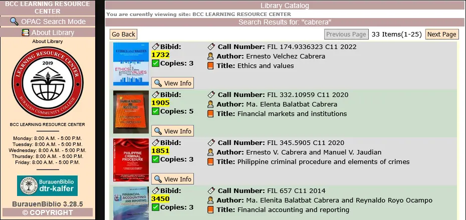

**Sistem BurauenBiblio** saat ini digunakan secara aktif di **Burauen Community College** untuk mendukung kegiatan katalogisasi perpustakaan dan layanan pencarian bibliografi bagi mahasiswa serta staf pengajar.

Sistem ini saat ini mengelola **4.808 rekaman bibliografi** dan **5.377 eksemplar buku**, dengan jumlah koleksi yang terus bertambah.

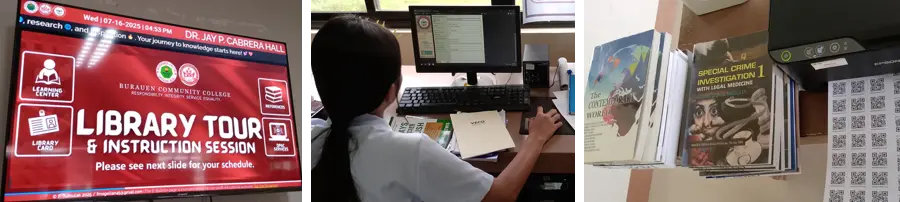

Informasi lebih lanjut:

- 🔗 https://librarytechnology.org/library/211849
- 🔗 https://librarytechnology.org/libraries/search.pl?Country=Philippines&Type=Academic

Demo langsung pencarian katalog OPAC BurauenBiblio:

- 🔗 https://drjaypcabrera.burauen.cc

BurauenBiblio dirancang untuk menyederhanakan operasional perpustakaan dengan menyediakan berbagai fitur **katalogisasi**, **manajemen sirkulasi**, **Online Public Access Catalog (OPAC)**, serta berbagai fitur yang dioperasikan oleh staf untuk meningkatkan **otomatisasi pekerjaan perpustakaan**.

Sistem ini telah ditingkatkan untuk berjalan pada **PHP 8.3.36** terbaru, dengan peningkatan kinerja yang signifikan hingga **2–4 kali lebih cepat dibandingkan PHP 5.7**, sekaligus mempertahankan **kompatibilitas penuh** dengan perangkat keras lama yang masih digunakan oleh perguruan tinggi.

Jika Anda ingin mencoba BurauenBiblio menggunakan database OpenBiblio yang sudah dimiliki:

[Lihat: 🧹 Utilitas - Pengelola Migrasi Database](#-utilitas---pengelola-migrasi-database)

## 📚 Pembaruan Antarmuka Login dan Halaman Selamat Datang

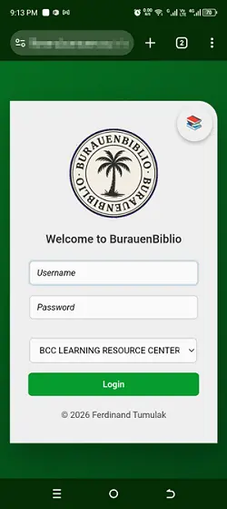

Antarmuka halaman login dan selamat datang telah diperbarui dengan tampilan Progressive Web App yang lebih bersih, modern, dan responsif.

Pembaruan ini meningkatkan kejelasan visual, aksesibilitas, serta kenyamanan penggunaan pada perangkat seluler dengan tetap mempertahankan kompatibilitas penuh terhadap sistem autentikasi BurauenBiblio dan struktur tema lama. Tidak ada perubahan pada logika inti proses login.

## 📚 Pencarian dan Pengunduhan eBook OPAC (Integrasi Gutendex)

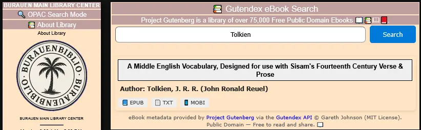

BurauenBiblio kini dilengkapi dengan modul pencarian eBook ringan yang didukung oleh [Gutendex API](https://gutendex.com/).

Gutendex merupakan API web sederhana yang dapat digunakan untuk menyediakan informasi katalog buku dari [Project Gutenberg](https://www.gutenberg.org/), sebuah perpustakaan daring yang menyediakan eBook gratis.

Lisensi MIT. Hak Cipta © 2017 Gareth Johnson.

https://github.com/garethbjohnson/gutendex

### ✨ Fitur

- Mencari lebih dari 75.000 judul eBook domain publik langsung melalui BurauenBiblio.
- Melihat detail buku dan format yang tersedia (EPUB, TXT, MOBI).
- 100% gratis dan bersumber terbuka, cocok untuk kebutuhan pendidikan dan perpustakaan.
- Fitur pencarian eBook terintegrasi dalam modul OPAC.

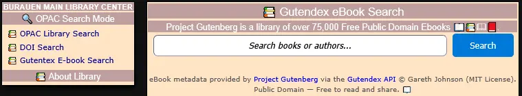

### ⚖️ Lisensi dan Atribusi

Fitur ini mengakses metadata dan berkas eBook yang dihosting oleh **Project Gutenberg**.

Seluruh eBook yang tersedia merupakan bagian dari domain publik di Amerika Serikat dan sebagian besar wilayah dunia lainnya, tanpa biaya dan tanpa pembatasan penggunaan.

BurauenBiblio **tidak menyimpan maupun menggandakan (mirror)** berkas eBook. Seluruh hasil pencarian mengarah langsung ke server resmi Project Gutenberg.

## 📌 Fitur Lainnya

### 📦 Generator QR Code dan Fitur Cetak Massal

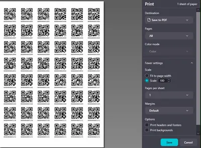

Fitur ini menambahkan sistem pembuatan QR Code dan pencetakan massal ke dalam BurauenBiblio. Sistem dirancang dengan mempertimbangkan ketahanan label, efisiensi pencetakan, dan kebutuhan operasional perpustakaan sehari-hari.

Fitur ini mendukung pencetakan QR Code untuk buku maupun anggota perpustakaan (misalnya nomor ID mahasiswa atau ID staf pengajar).

Proses pencetakan mendukung satu QR Code maupun beberapa QR Code sekaligus. Fitur ini sangat berguna untuk pelabelan halaman dalam buku dan sampul belakang.

✨ **Ringkasan Fitur**

- Menghasilkan QR Code dari identitas numerik 13 digit untuk buku.
- Menghasilkan QR Code untuk anggota perpustakaan (kode mahasiswa/staf pengajar 8 digit).
- Mendukung pencetakan satu QR Code maupun tiga QR Code sekaligus (label buku).
- Menyimpan gambar QR dalam format PNG agar dapat digunakan kembali untuk pencetakan massal.
- Menghasilkan tata letak 6 × 8 QR Code (label buku).
- Menghasilkan 48 QR Code untuk anggota perpustakaan.
- Dioptimalkan untuk kertas ukuran A4 (210 mm × 297 mm).
- Menghindari masalah pemudaran hasil cetak pada printer termal dengan menggunakan printer inkjet atau laser.

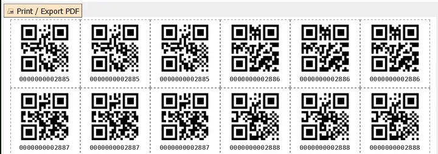

Dengan pendekatan ini, perpustakaan dapat mencetak label QR satu kali, kemudian memotong dan menempelkannya pada buku sesuai kebutuhan.

🖨️ **Petunjuk Pencetakan**

Setiap QR Code buku membutuhkan nomor identifikasi 13 digit.

- Menghasilkan hingga 16 QR Code dalam satu proses pencetakan menggunakan kertas A4.
- Setiap QR Code dicetak sebanyak tiga kali pada satu lembar:

  - Sampul depan (bagian dalam).
  - Sampul belakang (bagian dalam).
  - Sampul belakang (dekat ringkasan buku).

### 📌 Pengelola Kalender

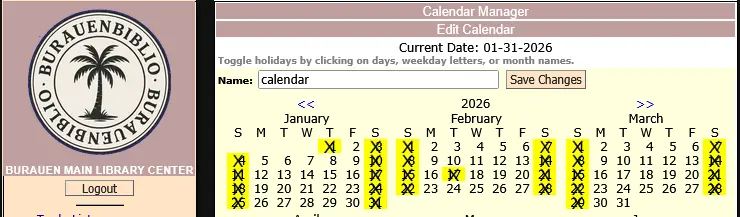

Sistem menggunakan **Logika Kalender (Calendar Logic)** untuk menghitung tanggal jatuh tempo secara akurat berdasarkan **hari operasional dan hari libur perpustakaan**.

### 📌 Pengaturan Batas Denda Keterlambatan

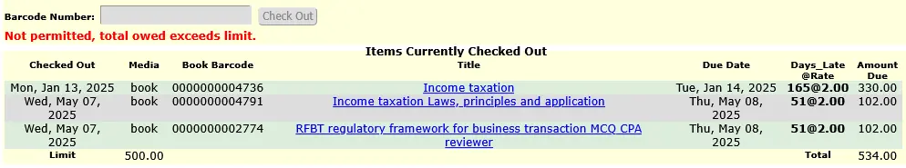

Jenis anggota dapat dikonfigurasi dengan pengaturan **denda keterlambatan** masing-masing.

Apabila anggota melewati batas denda keterlambatan yang terakumulasi berdasarkan penalti per hari, anggota tersebut akan **dibatasi untuk melakukan peminjaman tambahan**.

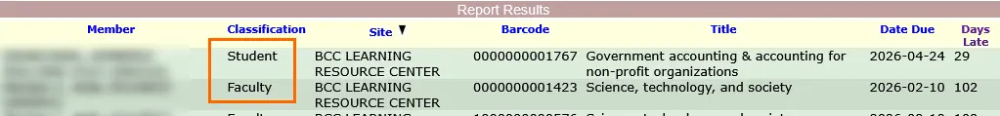

Laporan keterlambatan telah ditingkatkan dengan menambahkan kolom **klasifikasi anggota** yang menunjukkan apakah peminjam merupakan mahasiswa, staf pengajar, atau kategori lainnya.

Peningkatan ini memudahkan staf perpustakaan memahami konteks setiap catatan keterlambatan dan menentukan tindak lanjut yang perlu diprioritaskan.

### 📌 Manajemen Koleksi (Kebijakan Peminjaman dan Jenis Koleksi Kustom)

Halaman **Manajemen Koleksi** digunakan untuk mengatur **tarif denda** dan **durasi peminjaman** untuk setiap jenis koleksi.

Selain itu, pengguna dapat menambahkan jenis koleksi khusus yang nantinya akan tersedia pada menu dropdown 'New Item' di bagian katalog.

Jenis koleksi baru seperti jurnal, tesis, dan berbagai bahan penelitian lainnya dapat ditambahkan ke dalam konfigurasi katalog sesuai kebutuhan perpustakaan sekolah.

### 📌 Pencarian DOI melalui OPAC

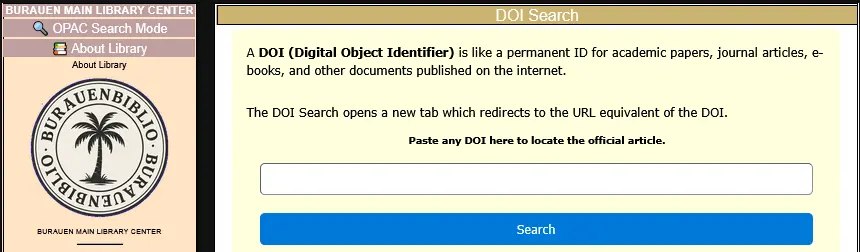

Fitur **Pencarian DOI** memungkinkan resolusi DOI menjadi URL, sehingga anggota perpustakaan dapat langsung diarahkan ke **sumber artikel resmi dan otoritatif**, seperti penerbit, repositori, atau platform akses terbuka di internet.

| **Manfaat** | **Tanpa Pencarian DOI** | **Dengan Pencarian DOI** ✅ |
|---|---|---|
| **Menemukan artikel dengan cepat** | Mencari judul panjang melalui Google | Masukkan DOI → Tautan langsung |
| **Sumber tepercaya** | Hasil pencarian bercampur antara blog, PDF, dan sumber lainnya | Langsung menuju penerbit resmi |
| **Menghemat waktu** | Banyak klik dan percobaan pencarian | Satu pencarian → satu hasil |
| **Mendukung penelitian** | Berisiko memperoleh informasi usang atau tidak terverifikasi | Akses langsung ke sumber ilmiah |

### 📌 Daftar Tugas (To-Do List)

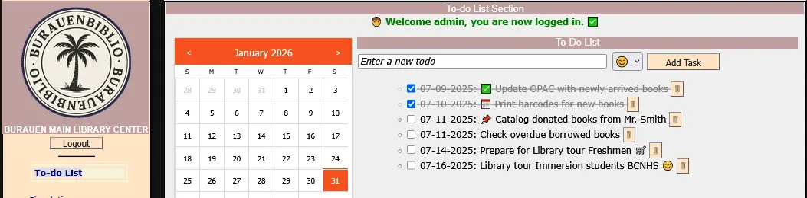

Fitur **To-Do List** merupakan peningkatan sederhana namun bermanfaat pada sistem perpustakaan BurauenBiblio.

Fitur ini memungkinkan staf perpustakaan untuk dengan mudah **mencatat, mengatur, dan berbagi catatan penting, pengingat, serta tugas** langsung melalui antarmuka sistem perpustakaan.

Baik untuk merencanakan kegiatan mendatang, memantau tugas rutin, mengingatkan rekan kerja mengenai jadwal perpustakaan, maupun mencatat ide secara cepat, fitur To-Do List membantu seluruh staf tetap terkoordinasi.

### 📌 Kartu Katalog (Card Catalog)

**BurauenBiblio** mendukung pencetakan kartu katalog dalam format PDF khusus berukuran **8 × 5 inci**, dengan ruang yang cukup untuk judul panjang, barcode, dan istilah subjek.

Tata letak ini dirancang untuk penggunaan kertas *long bond* berukuran **8,5 × 13 inci**, sehingga dua kartu katalog dapat dicetak dalam satu lembar.

Sistem mendukung pencetakan **kartu judul, kartu pengarang, dan kartu subjek**, memberikan fleksibilitas lebih bagi perpustakaan yang masih menggunakan katalog kartu fisik.

Fitur ini dirancang sebagai solusi praktis dan hemat sumber daya bagi perpustakaan lokal yang membutuhkan kartu katalog cetak untuk koleksinya.

### 📌 Pengaturan Tag MARC

Berkas SQL yang disertakan menyediakan entri tag MARC yang disesuaikan untuk rekaman bibliografi yang kompatibel dengan kebutuhan perpustakaan di **Filipina**.

Anda juga dapat menyesuaikan atau memperluas entri tersebut agar sesuai dengan standar katalogisasi perpustakaan di negara masing-masing maupun persyaratan institusi melalui pengaturan **Biblio Fields**.

### 📌 Pengambilan Metadata Daring melalui SRU dan Z39.50

- **Integrasi SRU Perpustakaan Umum** – Menambahkan dukungan pencarian katalog perpustakaan melalui endpoint SRU menggunakan rekaman MARCXML.
- **Konfigurasi SRU Berbasis Provider** – Mengelola berbagai penyedia SRU secara terpisah, termasuk endpoint, versi SRU, skema rekaman, indeks CQL, relasi, dan pengaturan permintaan. (Endpoint SRU yang tersedia saat ini masih terbatas pada beberapa layanan publik yang umum digunakan.)

Pencarian katalog daring kini secara otomatis menentukan penggunaan protokol Z39.50 atau SRU berdasarkan konfigurasi layanan masing-masing host, sehingga kedua protokol dapat digunakan secara bersamaan.

Teknologi ini umum digunakan untuk mencari katalog jarak jauh dan mengambil rekaman bibliografi, termasuk rekaman yang dikodekan dalam format MARC.

BurauenBiblio memerlukan ekstensi PHP/YAZ yang telah terpasang dan diaktifkan agar protokol Z39.50 dapat digunakan.

📌 Lihat [How to add SRU providers.md](./How%20to%20add%20SRU%20providers.md) untuk informasi mengenai penambahan penyedia SRU.

📌 Lihat [how to install yaz into burauenbiblio container.md](./how%20to%20install%20yaz%20into%20burauenbiblio%20container.md) untuk informasi mengenai instalasi ekstensi YAZ.

### 📌 Dukungan Bahasa Lain

- Dukungan dasar **Bahasa Indonesia** telah ditambahkan (termasuk tag MARC).

### 📦 Keranjang Reservasi Buku (Booked Items Cart)

**Booked Items Cart** merupakan daftar reservasi buku yang diajukan oleh anggota perpustakaan.

Fitur ini mendukung reservasi judul tertentu, buku dengan permintaan tinggi, dan bahan pustaka yang sering dipinjam, dengan sistem berdasarkan urutan permintaan (*first-come, first-served*) dan pencatatan oleh staf perpustakaan.

Daftar reservasi juga menyediakan tautan dinamis menuju formulir anggota yang mengajukan permintaan.

### 📚 Keranjang Item Bertanda (Tagged Items Cart)

**Tagged Items** merupakan keranjang peninjauan sementara untuk rekaman bibliografi yang memerlukan perhatian lebih lanjut.

Fitur ini membantu staf mengidentifikasi bahan pustaka yang memiliki metadata tidak lengkap, konflik nomor panggil (*call number*), rekaman duplikat, atau permasalahan kondisi fisik.

Dengan demikian, proses pembersihan data dan pengendalian kualitas katalog dapat dilakukan secara lebih terarah.

## 📝 Analitik

### 📈 Analitik Pertumbuhan Koleksi

Modul **Analitik Pertumbuhan Koleksi (Collection Growth Analytics)** menyediakan gambaran visual mengenai perkembangan katalog perpustakaan dari waktu ke waktu.

Modul ini menggabungkan jumlah rekaman bibliografi dan eksemplar fisik yang ditambahkan setiap minggu, kemudian menyajikannya melalui grafik interaktif menggunakan Chart.js.

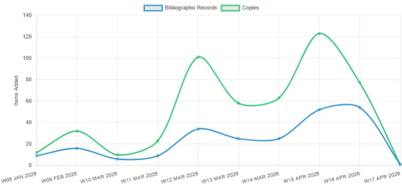

**Manfaat utama:**

- Memantau pertumbuhan rekaman bibliografi dan eksemplar setiap minggu.
- Menyediakan visualisasi tren perkembangan koleksi.
- Membantu mengidentifikasi periode katalogisasi yang aktif maupun kesenjangan dalam pengadaan koleksi.
- Mendukung kebutuhan pelaporan administrasi dan akreditasi.
- Meningkatkan kualitas pengambilan keputusan untuk perencanaan pengembangan koleksi di masa mendatang.

### 📝 Analitik - Laporan Sirkulasi Bulanan

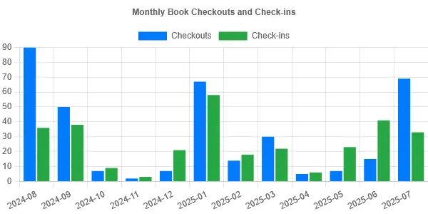

**Laporan Sirkulasi Bulanan (Monthly Circulation Report)** merupakan fitur analitik dinamis pada BurauenBiblio yang menampilkan visualisasi **jumlah total bahan pustaka yang dipinjam setiap bulan** berdasarkan rentang waktu yang dipilih.

Fitur ini membantu staf perpustakaan dan administrator untuk:

- 📅 **Memantau Tren Peminjaman**
- 📚 **Mengevaluasi Pola Penggunaan Koleksi**
- 🎯 **Mendukung Pengambilan Keputusan** berdasarkan permintaan dan kebutuhan aktual.

### 📝 Analitik - Laporan Buku Hilang

**Laporan Buku Hilang (Missing Books Report)** menyediakan daftar terorganisasi mengenai buku dan bahan pustaka lainnya yang telah diidentifikasi sebagai hilang.

Setiap entri terhubung langsung dengan rekaman katalog terkait, sehingga staf perpustakaan dapat meninjau, memverifikasi, dan memelihara catatan bahan pustaka yang hilang secara lebih efisien.

Buku atau bahan pustaka dapat ditandai sebagai hilang dengan memasukkan kata kunci khusus **ITEM-IS-MISSING** pada kolom deskripsi melalui formulir **Edit Copy Properties**.

BurauenBiblio kemudian menggunakan identitas tersebut untuk menghasilkan laporan bahan pustaka hilang yang terorganisasi dan transparan.

Laporan ini juga menyediakan fungsi **Export to JSON**, yang memungkinkan seluruh daftar bahan pustaka hilang beserta informasi katalog terkait diekspor ke dalam format JSON terstruktur untuk pemrosesan lebih lanjut, pengarsipan, maupun analisis data.

### 📝 Analitik - Statistik Dewey Decimal Classification (DDC)

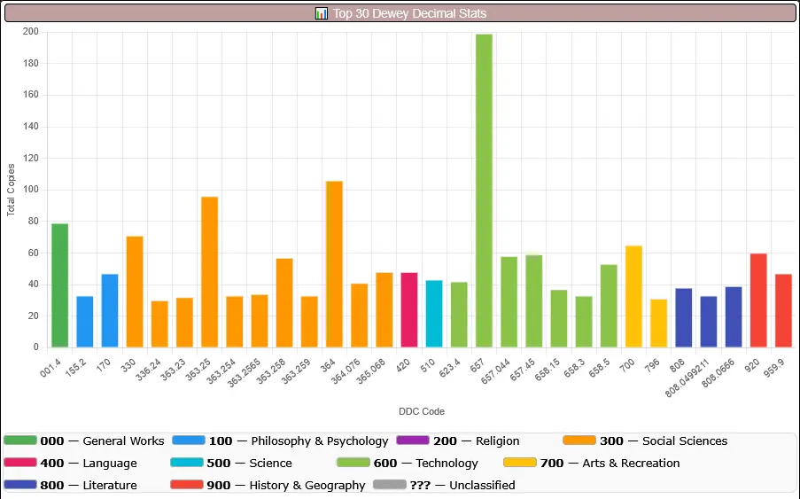

Fitur **DDC Stats** menyediakan analisis koleksi perpustakaan melalui visualisasi **jumlah eksemplar berdasarkan kategori Dewey Decimal Classification (DDC)**.

Fitur ini juga dilengkapi utilitas untuk membuat tabel DDC yang diperlukan dalam menghasilkan grafik (Jumlah Eksemplar dibandingkan Kode DDC).

Utilitas DDC memerlukan jumlah buku yang telah dikatalogisasi menggunakan sistem DDC agar dapat menghasilkan grafik yang bermakna.

Fitur ini juga mendukung ekspor CSV serta pembuatan **DDC Holdings Summary by Copyright Year**, yaitu ringkasan kepemilikan koleksi berdasarkan tahun hak cipta dengan pengelompokan rentang 5 tahun dan 10 tahun, menggunakan tahun berjalan sebagai acuan.

Fitur **Export to JSON** juga telah ditambahkan untuk memungkinkan data ditampilkan dalam format JSON dan dimanfaatkan oleh layanan lain, misalnya e-bulletin.

> Deskripsi kategori DDC diadaptasi dari [Wikipedia](https://en.wikipedia.org/wiki/List_of_Dewey_Decimal_classes) berdasarkan lisensi [CC BY-SA 4.0](https://creativecommons.org/licenses/by-sa/4.0/).

### 📝 Pemetaan Dewey Decimal Classification Tingkat Lanjut

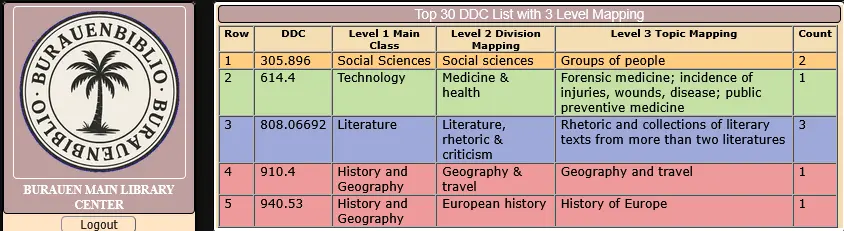

Fitur ini memperkaya rekaman bibliografi dalam **BurauenBiblio** dengan menginterpretasikan nomor **Dewey Decimal Classification (DDC)** mentah secara dinamis menjadi kategori subjek yang terstruktur dan mudah dipahami.

#### ⚙️ Cara Kerja: Pipeline Pemrosesan 3 Tingkat

Sistem menggunakan tiga fungsi helper internal untuk mengurai nomor panggil secara berurutan berdasarkan skema referensi akses terbuka (dengan taksonomi tingkat atas yang diadaptasi dari Wikipedia berdasarkan lisensi **CC BY-SA 4.0**).

Proses ini membagi data menjadi tiga tingkatan yang berbeda dan deterministik:

1. **Tingkat 1 (Kelas Utama / Main Class):** Mengidentifikasi kategori umum berdasarkan kelompok ratusan, misalnya `300 — Social Sciences`.

2. **Tingkat 2 (Divisi / Division Class):** Mengekstrak pemetaan disiplin ilmu tingkat sepuluh, misalnya `330 — Economics`.

3. **Tingkat 3 (Topik / Topic Class):** Mengidentifikasi topik khusus yang ditetapkan pada setiap eksemplar fisik maupun digital.

Setelah seluruh proses pemetaan tiga tingkat selesai, data akan diindeks ke dalam tabel staging dinamis (`extract_ddc`) sehingga dapat langsung digunakan untuk pelaporan internal maupun penelitian ilmiah eksternal.

#### Ringkasan Koleksi DDC Berdasarkan Tahun Hak Cipta

**DDC Holdings Summary by Copyright Year** menyediakan gambaran terstruktur mengenai koleksi buku perpustakaan berdasarkan **bidang subjek Dewey Decimal Classification (DDC)**, termasuk jumlah **judul unik dan total eksemplar yang dimiliki**.

Laporan ini juga mengidentifikasi buku yang memiliki tahun hak cipta dalam rentang **10 tahun terakhir** dan **5 tahun terakhir**, sehingga staf perpustakaan dapat menilai tingkat kebaruan koleksi pada setiap bidang subjek.

Informasi tersebut dapat menjadi dasar yang berguna untuk **evaluasi koleksi, perencanaan pengadaan, serta identifikasi bidang subjek yang memerlukan pembaruan atau penambahan sumber referensi**.

Ringkasan yang dihasilkan disajikan dalam format tabel yang ringkas, memperlihatkan jumlah keseluruhan koleksi beserta rentang tahun hak cipta 10 tahun dan 5 tahun.

Hal ini memungkinkan perpustakaan membandingkan ukuran serta tingkat kebaruan koleksi antarbidang DDC secara cepat dan mendukung pengembangan koleksi yang lebih terarah.

#### 📊 Penerapan untuk Institusi dan Penelitian

Fitur **DDC Stats**, **DDC Holdings Summary**, dan **Full DDC Table Listings** memberikan kemampuan kepada administrator perpustakaan untuk:

- **Mengidentifikasi Kekuatan Koleksi:** Mengetahui secara langsung kelas akademik atau disiplin ilmu yang mendominasi koleksi aktif perpustakaan.

- **Melakukan Analisis Kesenjangan (Gap Analysis):** Mengidentifikasi kategori yang kurang terwakili, terutama ketika bahan referensi utama atau sumber pembelajaran sesuai kurikulum masih terbatas.

- **Mendukung Pengadaan Berbasis Data:** Mengambil keputusan berdasarkan data untuk pengadaan buku, peninjauan inventaris secara sistematis, dan alokasi anggaran tahunan.

- **Mendukung Kepatuhan dan Akreditasi:** Menunjukkan keragaman serta kedalaman koleksi kepada pemangku kepentingan, manajemen, maupun lembaga akreditasi institusi.

- **Mengurangi Audit Manual:** Menghemat waktu administrasi secara signifikan dibandingkan analisis daftar rak (*shelf-list*) koleksi secara manual.

#### 💾 Fitur Tambahan: Ekspor Dataset Lengkap (`.json` / `.csv`)

Meskipun dashboard administrator utama menyediakan tampilan terkurasi dan terstruktur untuk **30 Klasifikasi DDC Teratas**, fitur ekspor tambahan yang baru dikembangkan memungkinkan administrator sistem mengambil profil seluruh koleksi aktif perpustakaan tanpa batasan tersebut.

Pipeline ekspor ini menghindari batas penggunaan memori browser dengan mengalirkan seluruh data klasifikasi ke dalam format berkas sederhana (*flat-file*).

Fitur ini memungkinkan integrasi yang lebih mudah dengan sistem penyimpanan data eksternal, eksekusi skrip statistik, maupun pengunggahan langsung ke repositori data sains terbuka.

### 📝 Analitik - 30 Buku Paling Banyak Dipinjam dan 30 Buku Paling Banyak Dibaca

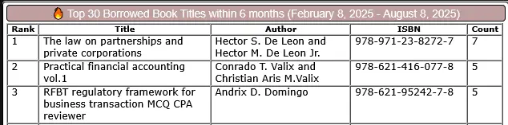

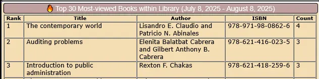

Daftar **30 Buku Paling Banyak Dipinjam (Top 30 Borrowed Books)** menampilkan judul buku yang paling sering dipinjam selama enam bulan terakhir. Data diambil dari laporan sirkulasi.

Sementara itu, **30 Buku Paling Banyak Dibaca (Top 30 Most-Viewed Books)** memantau buku yang sering dibaca atau digunakan sebagai referensi oleh anggota perpustakaan di dalam perpustakaan, tetapi tidak tercatat sebagai peminjaman resmi.

Aktivitas penggunaan di dalam perpustakaan ini diukur berdasarkan rentang aktivitas satu bulan.

Sebelum buku dikembalikan ke rak, staf dapat menggunakan formulir khusus **In-House Book Activity Tracker**:

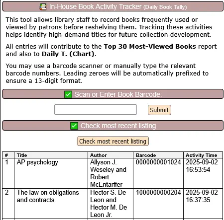

Dengan memindai barcode setiap buku menggunakan pemindai barcode atau memasukkan nomor secara manual, sistem akan **mencatat aktivitas buku secara otomatis** dan menyediakan opsi untuk **melihat item yang terakhir dipindai**.

Fitur ini membantu mengurangi ketergantungan pada pencatatan manual berbasis kertas sekaligus meningkatkan akurasi data.

Selain itu, jumlah aktivitas buku harian dapat **divisualisasikan melalui grafik interaktif** yang dilengkapi opsi **ekspor JSON** untuk pelaporan dan analisis data.

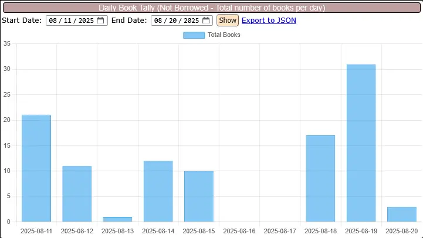

Kedua fitur Analitik Top 30 juga memiliki fungsi ekspor JSON berdasarkan Tahun-Bulan, sehingga staf perpustakaan dapat mengidentifikasi buku yang aktif digunakan berdasarkan konfigurasi tahun dan bulan tertentu.

Analitik ini memberikan wawasan berharga mengenai **tren membaca**, **preferensi mahasiswa**, dan **permintaan berdasarkan bidang subjek**.

Fitur tersebut mendukung pengembangan koleksi berbasis data sekaligus membantu perpustakaan beralih menuju alur kerja yang **lebih efisien dan minim penggunaan kertas**.

### 📝 Analitik - Pemantauan Kehadiran Perpustakaan

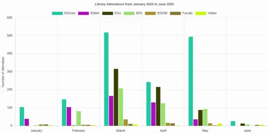

Sistem pencatatan ini dirancang untuk mendukung pelaporan statistik dan memberikan gambaran mengenai interaksi komunitas dengan perpustakaan.

Fitur ini memungkinkan pencatatan kunjungan bulanan berdasarkan jenis pengguna (Mahasiswa, Staf Pengajar, Pengunjung) dan, jika diperlukan, berdasarkan program akademik.

Dengan visualisasi dinamis yang didukung oleh Chart.js, staf perpustakaan dapat melihat tren kehadiran secara langsung berdasarkan rentang tanggal yang dipilih.

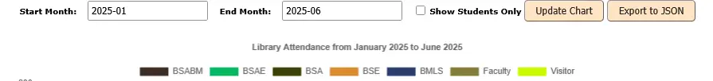

Fitur **Export attendance to JSON** telah ditambahkan, termasuk filter khusus untuk kategori mahasiswa (*student only*).

Data tersebut dapat digunakan oleh layanan lain yang mendukung format JSON, misalnya e-bulletin.

## 🧹 Utilitas

### 🧹 Utilitas - Pemeriksaan Thumbnail

Fitur **Thumbnail Check** merupakan utilitas untuk menemukan thumbnail yang hilang dan URL gambar rusak yang terhubung dengan rekaman bibliografi.

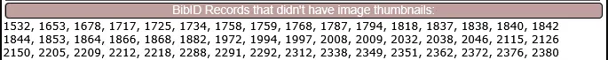

Fitur ini juga mencakup rekaman bibliografi yang tidak memiliki thumbnail, termasuk kondisi ketika formulir penambahan thumbnail dibatalkan.

### 🧹 Utilitas - Pembersihan Orphaned BibID

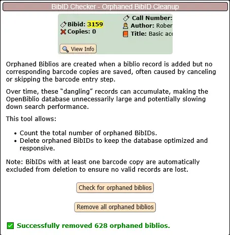

Alat ini membantu memelihara database OpenBiblio agar tetap **bersih dan optimal** dengan mengidentifikasi serta menghapus **rekaman bibliografi yatim (orphaned biblios)**, yaitu rekaman yang tidak memiliki eksemplar barcode terkait.

### 🧹 Utilitas - Pengelola Migrasi Database

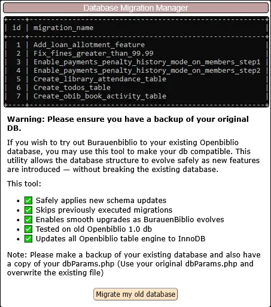

Jika Anda ingin mencoba BurauenBiblio menggunakan database OpenBiblio yang sudah dimiliki, Anda dapat menggunakan alat ini untuk menyesuaikan struktur database agar kompatibel.

Utilitas ini memungkinkan struktur database berkembang secara aman seiring penambahan fitur baru tanpa merusak database yang sudah ada.

> Catatan: Buatlah cadangan (*backup*) database yang sudah ada dan simpan salinan `dbParams.php` Anda. Gunakan berkas `dbParams.php` asli dan timpa berkas yang sudah ada.

Alat ini memiliki kemampuan:

- Menerapkan pembaruan skema database secara aman.
- Melewati migrasi yang telah dijalankan sebelumnya.
- Memungkinkan proses peningkatan versi berjalan dengan lancar seiring perkembangan BurauenBiblio.
- Telah diuji menggunakan database OpenBiblio 1.0 lama.
- Memperbarui seluruh engine tabel OpenBiblio menjadi InnoDB.

> Catatan: Perlu dipahami bahwa terdapat beberapa jenis database berbasis OpenBiblio dengan struktur skema yang sedikit berbeda. Lakukan pengujian migrasi secara menyeluruh pada lingkungan pengujian sebelum menerapkannya pada sistem produksi.

## 🙌 Arah Pengembangan Proyek

Proyek ini merupakan bagian dari inisiatif pribadi yang terus saya kembangkan untuk memodernisasi basis kode OpenBiblio.

Fokus pengembangan meliputi:

- Memperbaiki bug kritis.
- Meningkatkan antarmuka pengguna.
- Memperkenalkan fitur baru untuk meningkatkan kemudahan penggunaan dan kinerja.
- Setelah perbaikan pemilihan zona waktu selesai, dukungan bahasa lain kini memungkinkan untuk dikembangkan.
- Dukungan penuh untuk PHP 8.4.

Pembaruan terbaru juga mengintegrasikan **HTMX** dan berbagai perangkat frontend modern lainnya untuk menghadirkan pengalaman pengguna yang lebih dinamis dan responsif, tanpa beban tambahan dari framework JavaScript yang kompleks.

Pendekatan ini menjaga sistem tetap ringan, mudah diakses, dan sesuai untuk **perpustakaan kecil serta institusi pendidikan**, sekaligus mengikuti standar web modern.

Pada sisi backend, sebagian kode PHP prosedural lama telah direfaktor ke dalam struktur yang lebih **berorientasi objek (berbasis class)** untuk meningkatkan kemudahan pemeliharaan, penggunaan kembali kode, dan kejelasan struktur program secara keseluruhan.

Upaya modernisasi ini dibangun berdasarkan sistem **OpenBiblio** asli yang telah disesuaikan dengan kebutuhan perpustakaan di **Filipina**, dengan fokus utama pada **kinerja, kompatibilitas, dan kemudahan penggunaan**.

Jika Anda merasa proyek ini bermanfaat, silakan pertimbangkan untuk mendukung pengembangan saya.

## 🔖 Atribusi

Proyek ini menggunakan beberapa pustaka dan sumber daya sumber terbuka berikut:

- phpqrcode – Pembuatan QR Code (LGPL).
- DejaVu Sans Mono – Font label numerik (SIL Open Font License 1.1).
- HTMX – Antarmuka dinamis berbasis server (MIT).
- Chart.js – Visualisasi data (MIT).
- jsCalendar – Komponen antarmuka kalender untuk To-Do List (MIT).
- Gutendex – API katalog buku publik untuk Project Gutenberg (MIT).
- fpdf – Pembuatan berkas PDF secara langsung menggunakan PHP (Permissive License).

👀 Lihat [CREDITS.md](./CREDITS.md) untuk informasi atribusi tambahan atau kunjungi direktori LICENSES/.

## 📦 Instalasi

📌 Lihat [how_to_install.md](./how_to_install.md) untuk panduan instalasi.

## 📦 Catatan Teknis

📌 Lihat [TECHNICAL_NOTE.md](./TECHNICAL_NOTE.md) untuk informasi lebih lanjut.